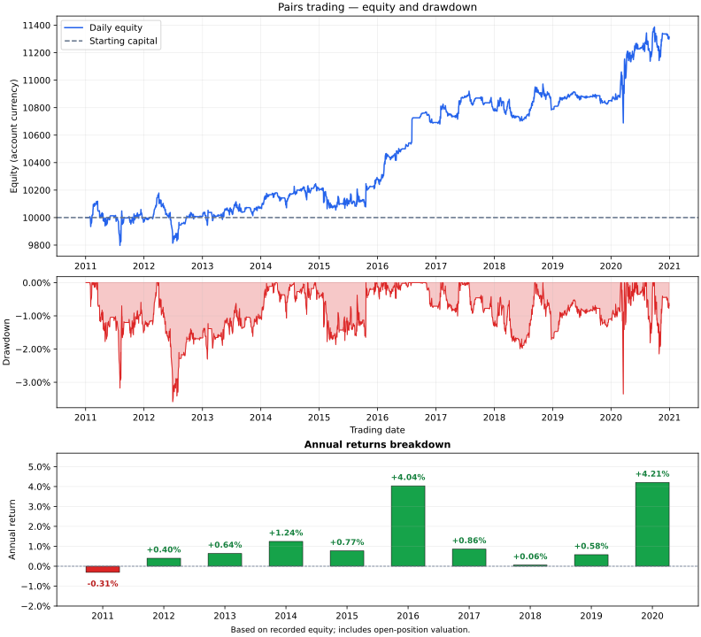
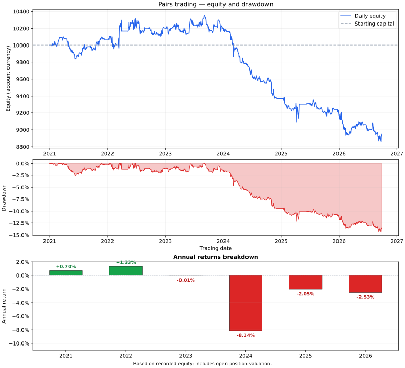
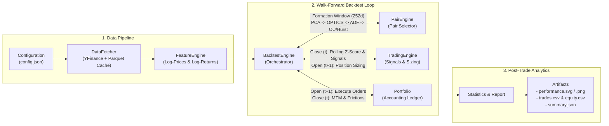

# Pairs Trading Engine

## Introduction

This repository implements an end-to-end pairs trading engine designed to take market-neutral positions. It is built
around a rolling walk-forward backtesting loop that evaluates entry and exit signals daily, periodically re-selects
tradable pairs, and executes submitted orders at $t+1$, avoiding look-ahead bias. Finally, the engine is fee-aware
(incorporating commissions, slippage, and short-borrowing costs), fully modular, and generates detailed performance
analytics and trade logs. Here is an example of the strategy's output:
<p align="center">
      
      <br>
      <em><b>Fig. 1</b> — Performance breakdown from the best in-sample configuration (Run 12, 2011–2020).</em>
</p>

---

## The Strategy

In this section, we dive into the strategy, from pair selection and signal generation to position sizing and trade
exits.

### Pair Selection

In pairs trading, cointegration is often treated as the sole criterion for selecting pairs. However, across a large
universe, this indicator alone shows clear limitations. Because it is purely
statistical and based on historical price series, two stocks might appear cointegrated over a specific window even
though they share no fundamental link and their relationship makes no economic
sense. Therefore, the implemented strategy uses a multi-step selection process to isolate
meaningful pairs with both an economic relationship and strong mean-reverting
behavior:

1. **Correlation Matrix**: We standardize the daily log-returns of all stocks over the formation window to compute their
   correlation matrix. This gives an $n \times n$ matrix (where $n$ is the
   stock universe size) in which all assets are equally weighted regardless of their individual volatility.

2. **PCA Reduction**: Using Principal Component Analysis, we extract the top $k = 5$ market factors (eigenvectors) from
   the correlation matrix. This produces a $k \times n$ matrix
   capturing the primary market drivers and each asset's sensitivity to them.
3. **OPTICS Clustering**: We transpose the PCA matrix to $n \times k$ and apply OPTICS density clustering to group
   stocks influenced by the same underlying factors (while filtering out isolated
   noise tickers). This is a key step: clusters represent assets with a genuine economic link, as their returns are
   driven by similar reactions to market factors, while also reducing the search space
   from $\mathcal{O}(n^2)$ to intra-cluster combinations.
4. **Cointegration Test (Engle-Granger)**: Within each cluster, we test every candidate pair in both directions on
   log-prices and retain the direction with the lowest $p$-value. An Ordinary Least Squares (OLS)
   regression estimates the hedge ratio $\beta$ and the spread, followed by an Augmented Dickey-Fuller (ADF) test on
   the residuals to confirm stationarity with $p\text{-value} \le 0.05$.
5. **Mean-Reverting Behavior**: To ensure a cointegrated pair reverts quickly and reliably enough to be traded
   profitably, we compute three key indicators on the spread:
    - **Hurst Exponent $(H)$**: Indicates whether the spread is genuinely mean-reverting $(H < 0.5)$ rather than
      random-walking or trending $(H \ge 0.5)$. The closer $H$ is to $0$, the stronger the mean reversion.
    - **Ornstein-Uhlenbeck Half-Life $(\tau_{1/2})$**: Estimates the expected time for the spread to
      revert halfway back to its equilibrium (retained within $(1, 365)$ days). Beyond confirming the presence of a
      restoring force, this metric also defines our dynamic time-stop: if a position remains open
      after $m \times \tau_{1/2}$ days, we assume the structural relationship has
      broken down and close the trade.
    - **Mean-Crossing Frequency**: Acts as an empirical safeguard to ensure the spread actively oscillates around its
      equilibrium. It counts how many times per year the spread crosses its mean (requiring $\ge 12$ crossings/year),
      filtering out slow candidates that drift on one side of equilibrium.
6. **Ranking**: To rank the pair candidates, we sort them by the highest mean-crossing frequency, shortest half-life,
   and finally
   the lowest $p$-value, retaining the top $N = 5$ pairs. This ranking prioritizes pairs with the strongest and fastest
   mean-reverting dynamics.

### Trading Signals

During the trading window, entry and exit signals are evaluated daily at market close:

1. **Spread Computation**: Over a rolling lookback window ( $W = 30$ trading days up to today's close), we compute the
   historical spread using the pre-estimated hedge ratio $\beta$ and intercept $\alpha$ on log-prices:
   $$S_t = \ln(Y_t) - \alpha - \beta \ln(X_t)$$
2. **Rolling Z-Score**: We normalize today's spread against its formation equilibrium mean ($\mu$) and $W$-day rolling
   standard deviation ($\sigma_W$):
   $$Z_t = \frac{S_t - \mu_W}{\sigma_W}$$

When scanning for new entries ($Z_{\text{entry}} = 3.0$ in our optimal run):
$$Z_t \ge +Z_{\text{entry}} \longrightarrow \textbf{Short Spread} \quad (\text{Short } Y,\ \text{Long } X)$$
$$Z_t \le -Z_{\text{entry}} \longrightarrow \textbf{Long Spread} \quad (\text{Long } Y,\ \text{Short } X)$$

Once an entry order is triggered at observed $Z_{\text{obs}}$ on signal date $t_{\text{signal}}$, three exit conditions
are defined and monitored daily:

1. **Take-Profit**: The spread reverts back to (or crosses beyond) equilibrium: $Z_t \le +Z_{\text{exit}}$ for a Short
   Spread, or $Z_t \ge -Z_{\text{exit}}$ for a Long Spread (e.g., $Z_{\text{exit}} = 0.25$).
2. **Dynamic Stop-Loss**: The spread diverges further beyond the entry
   level: $Z_t \ge Z_{\text{obs}} + \Delta Z_{\text{SL}}$ for a Short Spread,
   or $Z_t \le Z_{\text{obs}} - \Delta Z_{\text{SL}}$ for a Long Spread (e.g., $\Delta Z_{\text{SL}} = 1.5$).
3. **Time-Stop**: The trade exceeds its maximum expected convergence horizon based on the
   half-life, $t - t_{\text{signal}} \ge m \times \tau_{1/2}$ calendar days (e.g., $m = 3.0$).

If any of these conditions is met at the close of day $t$, an exit order is queued and executed at the next market
open ($t+1$).

### Position Sizing

Because we trade statistical anomalies, positions are sized to be **beta-neutral (market-neutral)** so that PnL is
driven by spread convergence rather than broad market direction.

First, we determine the capital allocated to the pair and enforce our neutrality constraints:
$$\text{Allocated Capital } (C) = \min(\text{allocation per pair} \cdot \text{Equity}_{t-1},\ \text{Available Cash})$$
$$\text{Exposure}_X = |\beta| \cdot \text{Exposure}_Y$$
$$\text{Exposure}_X + \text{Exposure}_Y = C$$

Solving for each leg's dollar allocation gives:
$$\text{Exposure}_Y = \frac{C}{1 + |\beta|} \qquad \text{and} \qquad \text{Exposure}_X = \frac{|\beta|}{1 + |\beta|} \cdot C$$

Finally, we compute the number of shares to trade on each leg at market open ($t+1$):
$$|\text{Quantity}_Y| = \frac{\text{Exposure}_Y}{\text{Price}_Y} \qquad \text{and} \qquad |\text{Quantity}_X| = \frac{\text{Exposure}_X}{\text{Price}_X}$$

*Note: These represent absolute share quantities (rounded down to $0.01$ share steps). In the portfolio ledger, the
shorted leg is recorded as a negative quantity.*

### Backtest Execution

The backtest engine consists of a rolling walk-forward loop which splits data into two consecutive slices: a **formation
window** of $252$ trading days ($\approx 1$ year) used to discover and rank pairs, followed by a **trading
window** of $10\text{--}40$ trading days ($10$ days in our optimal configuration) where those pairs are traded. Once the
trading window ends,
both windows move forward by the trading window length and the pair universe is re-evaluated.

Within each day $t$ of the trading window:

1. **Market Open ($t$)**: Pending orders generated at the previous close ($t-1$) are executed at opening prices
   (processing
   `EXIT` orders first to release capital before opening new positions, while ensuring no single stock is
   traded across multiple active pairs simultaneously).
2. **Market Close ($t$)**: Open positions are marked to market to update portfolio equity, and new entry/exit signals
   are evaluated on closing prices and queued for the next market open ($t+1$).

Finally, every trade is subject to realistic market frictions:

* **Transaction Costs (Entry & Exit)**: Applied to the gross dollar exposure ($E_{\text{gross}}$) of both legs upon
  opening and closing:
  $$\text{Transaction Fees} = E_{\text{gross}} \cdot (\text{commission\_pct} + \text{slippage\_pct})$$
* **Short-Borrowing Costs**: Applied on the initial shorted leg exposure ($E_{\text{short}}$) at annual
  rate $r_{\text{borrow}}$ over the holding duration (using an *Act/360* day-count
  convention) and deducted upon position closure:
  $$\text{Borrow Fees} = E_{\text{short}} \cdot r_{\text{borrow}} \cdot \frac{\text{Holding Days}}{360}$$

## Empirical Results

The strategy is evaluated on 200 established S&P 500 constituents (full ticker universe available in [
`config/config_in_sample.json`](config/config_in_sample.json) and [
`config/config_out_of_sample.json`](config/config_out_of_sample.json)). Two independent evaluation phases were
conducted: an **In-Sample optimization** (2010–2020) and an **Out-of-Sample validation** (2020–2026, with 2020 serving
as the initial 252-day formation window). In addition, results for all tested configurations are available in
[`docs/test_run`](docs/test_run). All subfolders are named according to their run ID and each contains the
following files:

- `equity.csv`: CSV file with the daily equity time series (`Date`, `equity`, `daily_return`, `cumulative_return`,
  `high_water_mark`, and `drawdown`).
- `performance.png` & `performance.svg`: Multi-panel tear sheet displaying the equity curve, underwater drawdown, and
  annual
  returns breakdown.
- `summary.json`: Backtest metadata, including traded period, warnings, and portfolio KPIs (Sharpe ratio,
  drawdown, number of trades, etc.).
- `trades.csv`: Full ledger of all closed trades (`pair`, `direction`, `entry_date`, `exit_date`, `duration_days`,
  `entry_zscore`, `exit_zscore`, `entry_exposure`, `gross_pnl`, friction breakdown, `net_pnl`, and `net_return_pct`).

### Static Backtest Configuration

Across all benchmark runs, the pair selection criteria and portfolio constraints remained fixed, while trading
thresholds, market frictions, and lookback windows were optimized. The template configuration below highlights the
parameters varied across benchmark runs:

```json
{
  "stocks": [
    "NVDA",
    "AAPL",
    "MSFT",
    "... (200 S&P 500 tickers)"
  ],
  "pair_selection": {
    "n_components": 5,
    "min_coverage": 0.95,
    "min_samples": 3,
    "significance_level": 0.05,
    "max_hurst": 0.5,
    "min_half_life": 1.0,
    "max_half_life": 365.0,
    "min_crossings": 12.0
  },
  "trading_config": {
    "entry_zscore": "<OPTIMIZED: 2.5 | 3.0 | 3.5>",
    "exit_zscore": "<OPTIMIZED: 0.00 | 0.25>",
    "stop_zscore_delta": "<OPTIMIZED: 0.5 | 1.0 | 1.5>",
    "half_life_time_exit_factor": 3.0,
    "zscore_window": "<OPTIMIZED: 15 | 30 | 60>",
    "max_position": 10,
    "pairs_top_n": 5,
    "allocation_per_pair": 0.15
  },
  "backtest_config": {
    "formation_window": 252,
    "trading_window": "<OPTIMIZED: 10 | 20 | 40>",
    "starting_capital": 10000,
    "commission_pct": "<0.0 In-Sample | 0.0005 OOS Net>",
    "slippage_pct": "<0.0 In-Sample | 0.0003 OOS Net>",
    "borrow_rate": "<0.0 In-Sample | 0.01 OOS Net>"
  }
}
```

### In-Sample Optimization (2010–2020)

The table below details the parameter optimization (conducted without market frictions):

|               Run                | Tested Parameter                             | Entry $Z$ | Exit $Z$ | SL $\Delta$ | $Z$-Win | Trade Win | Total Return |  Sharpe   |   Max DD   |  Winrate   | Profit Factor | Trades  | Phase Verdict                  |
|:--------------------------------:|:---------------------------------------------|:---------:|:--------:|:-----------:|:-------:|:---------:|:------------:|:---------:|:----------:|:----------:|:-------------:|:-------:|:-------------------------------|
| [`run_01`](docs/test_run/run_01) | Baseline model                               |   3.50    |   0.25   |    1.00     |   30    |    20     |    +6.46%    |   0.339   |   -4.81%   |   51.50%   |     1.300     |   233   | Initial baseline               |
| [`run_02`](docs/test_run/run_02) | Exit $Z \to \mathbf{0.00}$                   |   3.50    | **0.00** |    1.00     |   30    |    20     |    +6.50%    |   0.340   |   -4.81%   |   51.50%   |     1.302     |   233   | Identical dynamics             |
| [`run_03`](docs/test_run/run_03) | Entry $Z \to \mathbf{3.00}$                  | **3.00**  |   0.25   |    1.00     |   30    |    20     |   +11.34%    |   0.441   |   -4.36%   |   48.56%   |     1.297     |   383   | **Phase 1 Winner**             |
| [`run_04`](docs/test_run/run_04) | Entry $\mathbf{3.00}$ & Exit $\mathbf{0.00}$ | **3.00**  | **0.00** |    1.00     |   30    |    20     |    +9.59%    |   0.375   |   -4.31%   |   47.78%   |     1.249     |   383   | Waiting for $Z=0$ drags return |
| [`run_05`](docs/test_run/run_05) | Entry $Z \to \mathbf{2.50}$                  | **2.50**  |   0.25   |    1.00     |   30    |    20     |    +7.21%    |   0.262   |   -4.57%   |   47.04%   |     1.126     |   557   | Premature entries / noise      |
| [`run_06`](docs/test_run/run_06) | Entry $\mathbf{2.50}$ & Exit $\mathbf{0.00}$ | **2.50**  | **0.00** |    1.00     |   30    |    20     |    +6.05%    |   0.221   |   -5.37%   |   45.95%   |     1.105     |   555   | Lowest Sharpe in Phase 1       |
| [`run_07`](docs/test_run/run_07) | SL $\Delta \to \mathbf{1.50}$                |   3.00    |   0.25   |  **1.50**   |   30    |    20     |   +11.97%    |   0.465   |   -4.29%   |   52.66%   |     1.325     |   357   | **Phase 2 Winner**             |
| [`run_08`](docs/test_run/run_08) | SL $\Delta \to \mathbf{0.50}$                |   3.00    |   0.25   |  **0.50**   |   30    |    20     |    +6.32%    |   0.262   |   -5.34%   |   44.22%   |     1.154     |   441   | Tight stop suffocates trades   |
| [`run_09`](docs/test_run/run_09) | $Z$-Window $\to \mathbf{60}$                 |   3.00    |   0.25   |    1.50     | **60**  |    20     |    +0.87%    |   0.050   |   -8.29%   |   51.44%   |     1.025     |   208   | Excessive lag misses reversion |
| [`run_10`](docs/test_run/run_10) | $Z$-Window $\to \mathbf{15}$                 |   3.00    |   0.25   |    1.50     | **15**  |    20     |    +8.56%    |   0.299   |   -5.46%   |   49.26%   |     1.134     |   678   | Vulnerable to short-term noise |
| [`run_11`](docs/test_run/run_11) | Trade Window $\to \mathbf{40}$               |   3.00    |   0.25   |    1.50     |   30    |  **40**   |   +12.13%    |   0.450   |   -5.93%   |   49.09%   |     1.289     |   438   | Cointegration decays over 40d  |
| [`run_12`](docs/test_run/run_12) | Trade Window $\to \mathbf{10}$               | **3.00**  | **0.25** |  **1.50**   | **30**  |  **10**   | **+13.08%**  | **0.511** | **-3.59%** | **54.98%** |   **1.383**   | **331** | **In-Sample Champion**         |

The backtest ran from `2010-01-01` to `2020-12-31`, with 2010 serving as the initial 252-day formation window.

### Out-of-Sample Validation (2021–2026)

The following table illustrates how the champion configuration from the in-sample phase (`run_12`) performed on unseen
out-of-sample data (`2020-01-01` to `2026-09-30`, with 2020 serving as the initial formation window), both with and
without market frictions:

| Performance Metric           | In-Sample Champion ([`run_12`](docs/test_run/run_12)) | Out-of-Sample Gross ([`run_oos_gross`](docs/test_run/run_oos_gross)) | Out-of-Sample Net ([`run_oos_net`](docs/test_run/run_oos_net)) |
|:-----------------------------|:-----------------------------------------------------:|:--------------------------------------------------------------------:|:--------------------------------------------------------------:|
| **Total Return**             |                      **+13.08%**                      |                              **-5.82%**                              |                          **-10.51%**                           |
| **Annualized Return**        |                        +1.24%                         |                                -1.04%                                |                             -1.92%                             |
| **Annualized Volatility**    |                         2.47%                         |                                3.02%                                 |                             3.03%                              |
| **Sharpe Ratio**             |                      **+0.511**                       |                              **-0.332**                              |                           **-0.627**                           |
| **Max Drawdown**             |                      **-3.59%**                       |                             **-11.97%**                              |                          **-14.41%**                           |
| **Calmar Ratio**             |                        +0.346                         |                                -0.087                                |                             -0.133                             |
| **Winrate**                  |                      **54.98%**                       |                              **40.54%**                              |                           **38.92%**                           |
| **Profit Factor**            |                         1.383                         |                                0.803                                 |                             0.681                              |
| **Payoff Ratio**             |                         1.132                         |                                1.178                                 |                             1.069                              |
| **Average Holding Duration** |                      15.43 days                       |                              16.21 days                              |                           16.21 days                           |
| **Expectancy / Trade**       |                      **+$4.03**                       |                              **-$3.45**                              |                           **-$5.96**                           |
| **Total Closed Trades**      |                          331                          |                                 185                                  |                              185                               |
| **Total Cumulative Costs**   |                         $0.00                         |                                $0.00                                 |                            $495.19                             |

Here is the performance breakdown for the out-of-sample run including market frictions:
<p align="center">
      
      <br>
      <em><b>Fig. 2</b> — Out-of-Sample net performance breakdown with market frictions (2021–2026, through Sept 2026).</em>
</p>

As shown in **Figure 2**, the strategy was profitable from 2021 to 2022 and ended roughly flat in 2023. However, from
2024 onwards, performance degraded sharply with an annual return of -8.14% in 2024.

To better understand the strategy's behavior, we can audit the Out-of-Sample trade ledger ([
`docs/test_run/run_oos_net/trades.csv`](docs/test_run/run_oos_net/trades.csv)) grouped by trade exit year (with 2026
covering through `2026-09-29`):

|   Year   | Closed Trades |  Winrate  | Gross PnL (No Fees) | Total Frictions |   Net PnL    |
|:--------:|:-------------:|:---------:|:-------------------:|:---------------:|:------------:|
| **2021** |      33       |   42.4%   |      +$161.60       |     $91.27      | **+$70.29**  |
| **2022** |      25       |   44.0%   |      +$204.47       |     $70.75      | **+$133.71** |
| **2023** |      33       |   42.4%   |       +$28.89       |     $91.34      | **-$62.45**  |
| **2024** |      37       | **24.3%** |    **-$669.23**     |     $99.51      | **-$768.73** |
| **2025** |      31       |   41.9%   |       -$55.22       |     $76.15      | **-$131.37** |
| **2026** |      26       |   42.3%   |      -$277.38       |     $66.15      | **-$343.52** |

As this table shows, the strategy's winrate stayed remarkably consistent around 42%–44% in normal years. It
even generated positive net profits in 2022 (+1.33%) while the S&P 500 dropped ~18%, validating our
market-neutral approach. However, in 2024, the strategy suffered its worst year with its winrate cut nearly in half to
24.3% (accounting for ~70% of total closed-trade net losses). This breakdown can be explained by three main factors:

- **Regime Shift**: Pairs trading relies on the hypothesis that when the spread between two
  cointegrated peers diverges, it is a temporary anomaly that will revert to its mean. From 2024 onward, however,
  widespread AI adoption fundamentally shifted asset pricing. As documented by S&P Dow Jones Indices dispersion reports,
  companies were no longer driven primarily by shared macroeconomic
  factors, but rather by their individual exposure to AI. Because 2024 marked the onset of this boom, stocks underwent
  sudden structural repricings. Since our model relies on a backward-looking 252-day window to select pairs, it
  initially had no historical data reflecting this disruption, leading it to trade 2023-formed pairs whose cointegration
  had just broken down. In subsequent years (2025–2026), losses shrank significantly and the winrate recovered to ~42%.
  Once the 2024 shock entered the lookback window, the model began adapting to the new market dynamics, while remaining
  exposed to volatility spikes from ongoing AI breakthroughs.
- **Static OLS Hedge Ratio**: Because the hedge ratio $\beta$ and intercept $\alpha$ are estimated via a
  static OLS regression over a 252-day backward-looking formation window, sudden structural re-ratings take months
  to be fully reflected, leaving the spread model behind during rapid regime shifts.
- **Friction Drag**: Across all 185 closed trades, commissions, slippage, and short-borrow fees totaled **$495.19**
  —accounting for **47% of the overall net portfolio loss** (`-10.51%` Net vs. `-5.82%` Gross) and turning 2023 from a
  profitable gross year (`+$28.89`) into a slight net loss (`-$62.45`).

## Project Architecture

### Codebase Organization

The project's codebase is organized as follows:

```text
PairsTrading/
├── analysis/                  # Performance analytics, tear sheets & risk metrics
│   └── statistics.py          # Statistics class, SVG/PNG chart generator & CSV/JSON exporter
├── cache/                     # Local Parquet & JSON market data cache (SHA-256 keyed)
├── config/                    # Strategy and backtest configuration files
│   ├── config.json            # Default configuration file loaded by main.py
│   ├── config_in_sample.json  # 200 S&P 500 tickers & parameters for In-Sample runs (2010–2020)
│   └── config_out_of_sample.json # 200 S&P 500 tickers & parameters for OOS validation (2020–2026)
├── data/                      # Market data ingestion and feature engineering
│   ├── columns.py             # Enum definitions for OHLCV columns and computed features
│   ├── feature.py             # FeatureEngine (daily log-returns & log-prices)
│   └── fetcher.py             # DataFetcher (Yahoo Finance API downloader & local Parquet cache)
├── docs/                      # Stored benchmark outputs referenced in documentation
│   └── test_run/              # Full artifacts for run_01..run_12, run_oos_gross & run_oos_net
├── engine/                    # Core quantitative & execution engines
│   ├── backtest_engine.py     # Walk-Forward orchestrator (formation/trading splits & t+1 loop)
│   ├── pair_engine.py         # Pair selector (PCA, OPTICS, Engle-Granger, OU half-life, Hurst)
│   ├── portfolio.py           # Ledger tracking cash, positions, mark-to-market & frictions
│   └── trading_engine.py      # Rolling Z-score computation, entry/exit signals & beta-neutral sizing
├── models/                    # Immutable domain dataclasses and configuration schemas
│   ├── configuration.py       # PairSelectionConfig, TradingConfig, BacktestConfig
│   ├── order.py               # TradingOrder & TradingSignal (LONG_SPREAD, SHORT_SPREAD, EXIT, HOLD)
│   ├── pair.py                # Pair dataclass (OLS hedge ratio, p-value, Hurst, half-life, crossings)
│   ├── position.py            # PairPosition (quantities, gross/net PnL, commissions, slippage, borrow)
│   └── reporting.py           # Report dataclass encapsulating all portfolio & trade KPIs
├── reports/                   # Output directory for new backtest executions
├── scripts/                   # Automation & benchmark runners
│   └── run_all_benchmarks.py  # Automated runner for all 12 In-Sample and 2 OOS configurations
├── utils/                     # Configuration loader & input validation guards
│   ├── load_config.py         # JSON configuration parser
│   └── validation_utils.py    # Numerical & domain assertion helpers
├── main.py                    # Application entry point
└── requirements.txt           # Python dependencies
```

### Execution Pipeline



## How to Use

Follow these steps to set up and run the engine locally from the project root directory:

1. Create and activate a virtual environment (Python 3.13+):

```powershell
# Windows (PowerShell)
python -m venv .venv
.\.venv\Scripts\activate

# macOS / Linux
python3 -m venv .venv
source .venv/bin/activate
```

2. Install the required dependencies:

```powershell
pip install -r requirements.txt
```

3. Run a single backtest (using `config/config.json`) or reproduce the full benchmark suite:

```powershell
# Run default configuration (config/config.json -> writes output to ./reports/<timestamp>)
python main.py

# Reproduce all 12 In-Sample and 2 Out-of-Sample benchmark runs (note: clears and rewrites ./reports/)
python scripts/run_all_benchmarks.py
```

*Note: You can customize [`config/config.json`](config/config.json) to fit your needs (stock universe, date
range, selection criteria, Z-score thresholds, capital allocation, and fee structure).*

## Conclusion

This project marked my first step into quantitative finance. It helped me understand how to design and implement a
complete trading strategy alongside its own walk-forward backtesting engine. In addition, it taught me how to properly
test and validate a quantitative model using two separate datasets (In-Sample and Out-of-Sample), incorporate realistic
market frictions and borrowing fees, and evaluate
risk-adjusted metrics such as the Sharpe ratio and maximum drawdown. Throughout this project, I also learned the
fundamentals of statistical arbitrage, covering both the economic intuition and the mathematical foundations required to
select and trade meaningful pairs.

The key takeaways from this project are:

1. **Theory vs. Market Reality**: A pair being statistically tradable doesn't mean it will survive the markets. As we
   saw in the Out-of-Sample run in 2024, market regime shifts have a major influence on trading and can break a model
   that had previously delivered three years of consistent profit.
2. **Impact of Trading Fees**: At first, when I backtested my strategy without frictions, I saw promising profits. Once
   commissions, slippage, and short-borrowing fees were introduced, I discovered the hard reality of execution costs and
   how large their impact is (accounting for 47% of the Out-of-Sample net loss). This really taught me that in active
   trading, it is far better to take fewer high-conviction
   trades with larger expected payoffs than many small trades where profits are eaten away by frictions.
3. **Software Architecture as a Research Tool**: This project also taught me how important it is to design a modular
   architecture when building and extensively testing a strategy. Not only does it provide better readability and
   maintainability, but it also makes it possible to tweak parameters, audit trade logs, and run full benchmark suites
   within minutes.

Finally, to take this project further, several improvements could be
implemented:

1. **Hedge Ratio Reactivity**: As highlighted in the Out-of-Sample analysis, a static 252-day OLS hedge
   ratio is slow to update, making pairs fragile during sudden market regime shifts. We could experiment with
   shorter formation windows or implement a Kalman Filter to dynamically update $\beta_t$
   and $\alpha_t$ in real time.
2. **Survivorship Bias**: Because of free data availability limitations (Yahoo Finance), tests were
   conducted on current S&P 500 constituents with continuous trading history since 2010. Using a point-in-time
   historical constituent dataset (including delisted or acquired companies) would eliminate survivorship bias and make
   the backtest even more accurate.
3. **Position Sizing**: Currently, every pair is sized in the same way, using 15% of portfolio equity (capped by
   available cash). This
   allocation doesn't take into account how confident we are in the trade or its expected volatility. Instead of
   static sizing, we could implement a volatility-based approach or compute a confidence score for the pair that
   would decide how much capital to allocate. With dynamic position sizing, we could hold more positions simultaneously
   while
   limiting the impact of riskier trades.
4. **Market Regime Filters**: Currently, our system always trades, regardless of the broader market regime. As we saw in
   the
   Out-of-Sample run of 2024, this can lead to poor performance during high-dispersion periods. Therefore, implementing
   a filter to avoid trading
   during regimes of low asset correlation (for instance, when the total PCA explained variance drops below a threshold)
   could help prevent
   such losses.